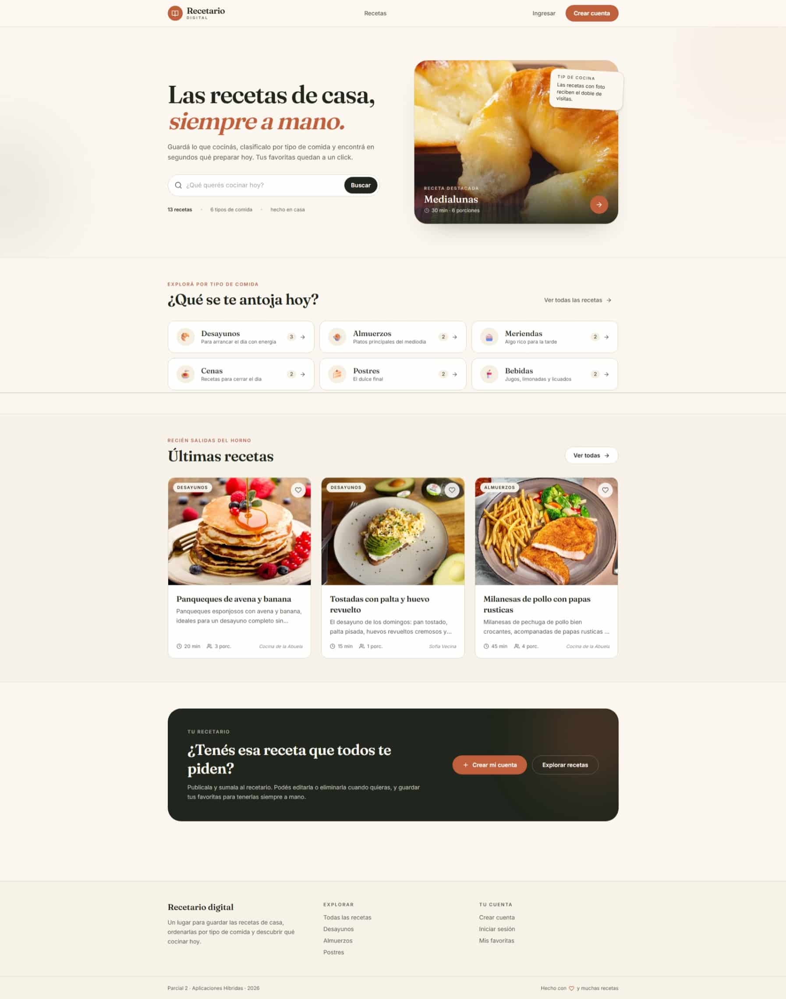
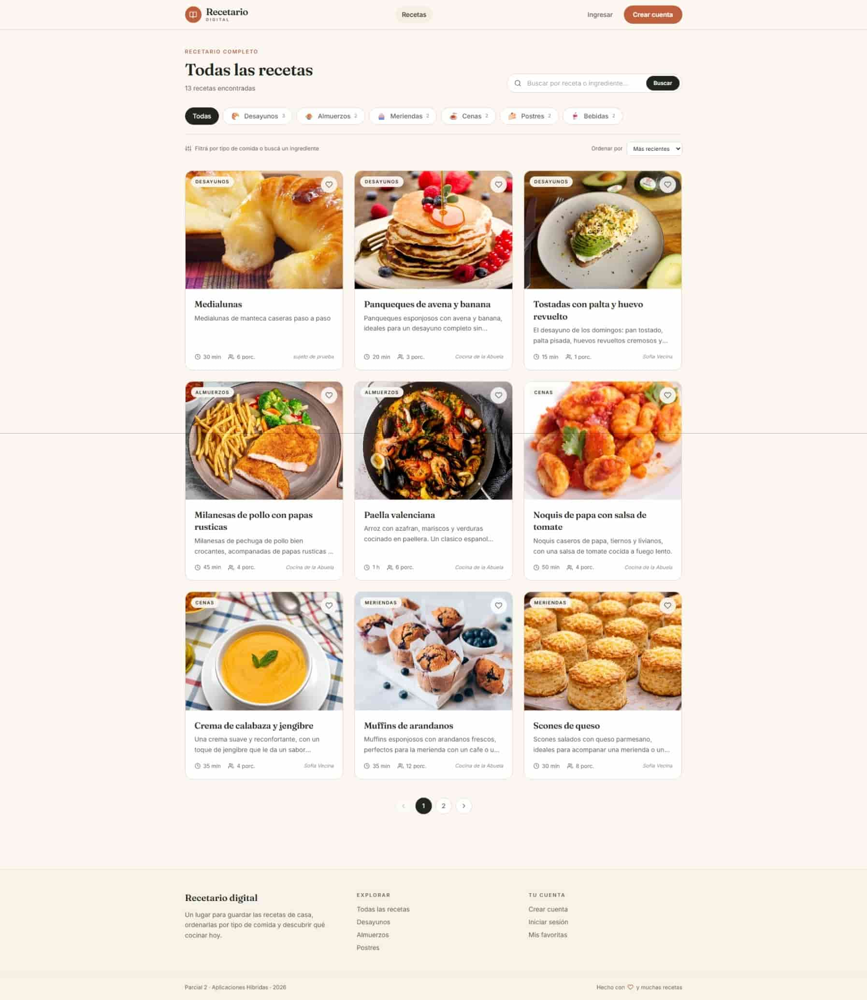
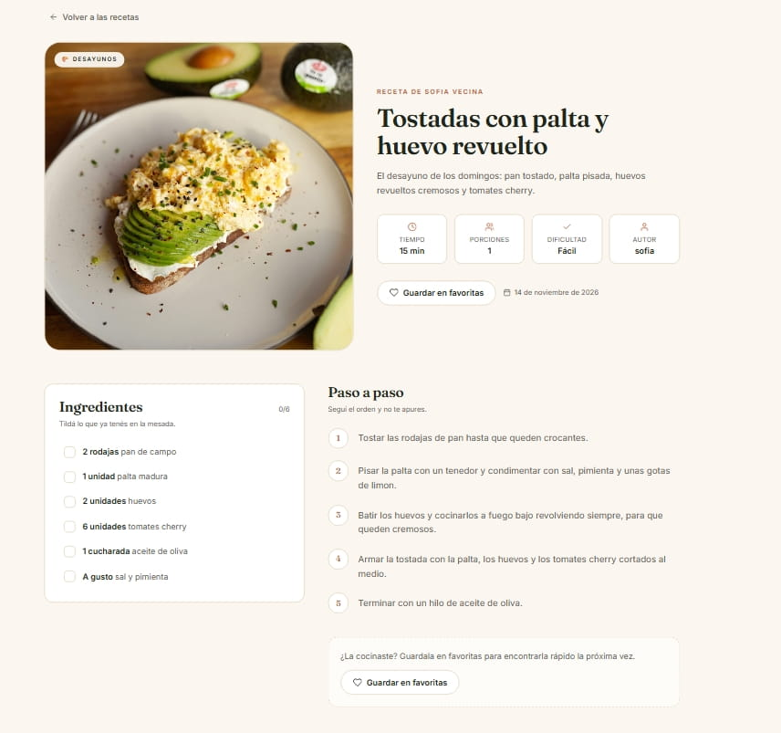
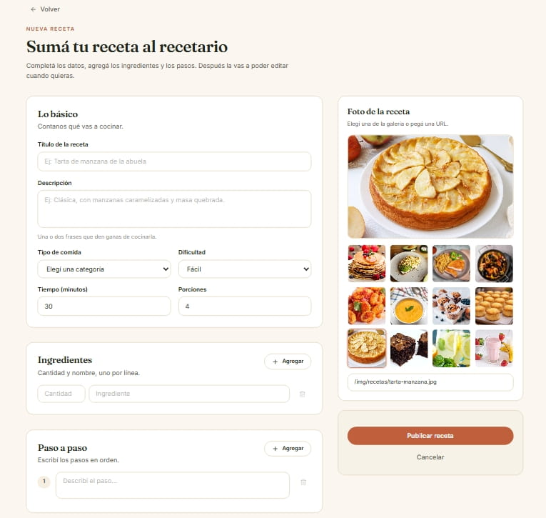
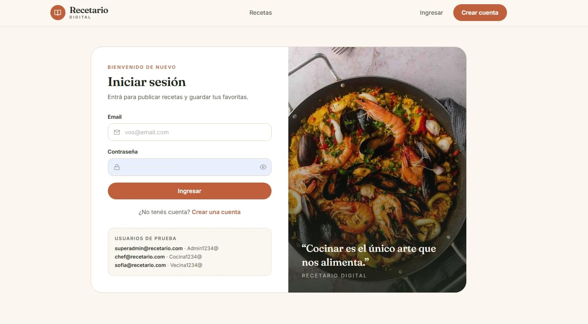
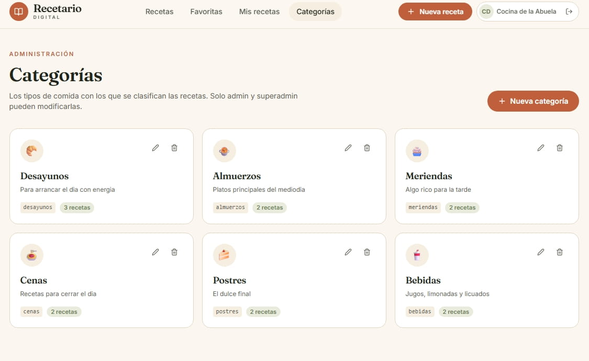
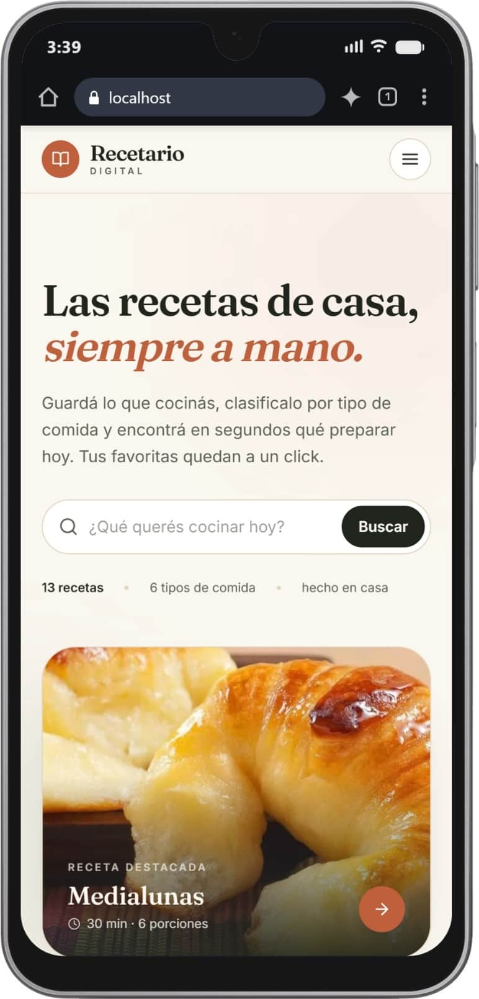
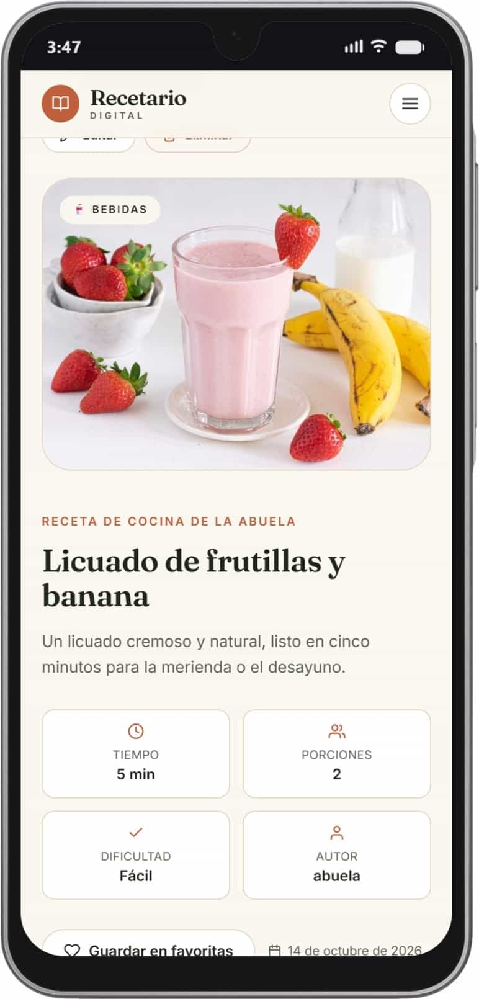

# Mi Recetario Digital

Aplicación full stack MERN para guardar recetas, organizarlas por tipo de comida, marcarlas como favoritas y descubrir nuevas preparaciones.

Trabajo práctico del **Parcial 2 de Aplicaciones Híbridas**



---

## 1. Temática y funcionalidades

**Mi Recetario Digital** es un recetario colaborativo: cualquier persona puede explorar el catálogo y, una vez registrada, publicar sus propias recetas.

| Funcionalidad pedida | Cómo está resuelta |
| --- | --- |
| Publicar recetas | Formulario con validación en front y back → `POST /api/recetas` (el autor se toma del JWT, nunca del body) |
| Clasificar por tipo de comida | Entidad **categorías** (CRUD propio) + campo `categoria` en cada receta |
| Guardar favoritas | Entidad **favoritos** por usuario, con `$lookup` a la receta |
| Agregar ingredientes y pasos | Arrays dentro de la receta, con `useFieldArray` para agregar/quitar filas |
| Buscar recetas por categoría | `GET /api/recetas?categoria=postres`, con chips de filtro y URLs compartibles |

Extras: buscador por título / descripción / ingrediente, orden por tiempo o alfabético, paginado, tildar ingredientes mientras cocinás, edición y borrado solo para el autor (o admin), panel de categorías y de usuarios.

---

## 2. Stack

**Backend** — Node.js + Express 5, MongoDB (driver oficial `mongodb`), JWT (`jsonwebtoken`), `bcrypt`, validación con `zod`, CORS.
**Frontend** — React 19 + Vite, React Router 8, Tailwind CSS 4, React Hook Form + `@hookform/resolvers` + `zod`, `jwt-decode`, `react-toastify`, `react-icons`.

---

## 3. Estructura del proyecto

```
recetario/
├── back/                      # API REST (Express + MongoDB)
│   ├── main.js                # Punto de entrada: middlewares globales y routers
│   ├── config.js              # Carga el .env y expone la configuración
│   ├── errors.js              # Helper para errores con status HTTP
│   ├── api/
│   │   ├── routes/            # Rutas: solo mapean URI + middlewares + controller
│   │   │   ├── users.route.js
│   │   │   ├── recetas.route.js
│   │   │   ├── categorias.route.js
│   │   │   └── favoritos.route.js
│   │   └── controllers/       # Reciben req/res, llaman al service y responden
│   ├── middlewares/           # validateToken, validateRoles y validadores zod
│   ├── services/              # Acceso a datos y reglas de negocio
│   │   ├── db.service.js      # Conexión única a MongoDB + helper ObjectId
│   │   ├── token.service.js   # Firma y verificación del JWT
│   │   ├── users.service.js
│   │   ├── recetas.service.js
│   │   ├── categorias.service.js
│   │   └── favoritos.service.js
│   ├── schemas/               # Schemas de zod (users, recetas, categorias)
│   ├── scripts/seed.js        # Datos de prueba (usuarios, categorías, recetas, favoritos)
│   └── public/img/recetas/    # Fotos que sirve la propia API
│
└── front/                     # SPA (React + Vite)
    ├── src/
    │   ├── main.jsx           # createBrowserRouter + providers + lazy loading
    │   ├── context/           # session, categorias y favoritos (estado global)
    │   ├── services/          # Lógica de APIs separada de las vistas
    │   ├── schemas/           # Validación con zod en el cliente
    │   ├── components/        # Componentes reutilizables
    │   ├── pages/             # Vistas por dominio (auth, recetas, categorias, users)
    │   ├── data/              # Galería de imágenes para el formulario
    │   └── utils/             # Formato de tiempo, fechas y dificultad
    └── public/fonts/          # Tipografías servidas localmente
```

---

## 4. Puesta en marcha

### Requisitos

- Node.js 20 o superior
- MongoDB (local en `mongodb://127.0.0.1:27017` o una URI de Atlas)

### 4.1 Backend

```bash
cd back
npm install
# El archivo .env ya está incluido; si falta, copiar .env.example a .env
npm run seed      # opcional: carga usuarios, categorías y 12 recetas de ejemplo
npm run dev       # nodemon → http://localhost:2026
```

Variables de `back/.env`:

| Variable | Ejemplo | Descripción |
| --- | --- | --- |
| `PORT` | `2026` | Puerto de la API |
| `MONGO_URI` | `mongodb://127.0.0.1:27017` | Conexión a MongoDB (local o Atlas) |
| `DNS_SERVERS` | `1.1.1.1,8.8.8.8` | Opcional; resolutores DNS para conexiones SRV con Atlas |
| `DB_NAME` | `recetario` | Nombre de la base |
| `JWT_SECRET` | `Clave secreta del recetario 2026` | Clave para firmar los tokens |
| `JWT_EXPIRES` | `2h` | Vigencia del token |
| `CORS_ORIGIN` | `http://localhost:5173` o `*` | Origen permitido |

Verificación rápida: `GET http://localhost:2026/api/health` → `{ "status": "ok", "db": "recetario" }`.

### 4.2 Frontend

```bash
cd front
npm install
npm run dev       # http://localhost:5173
```

Variables de `front/.env.development`:

| Variable | Ejemplo | Descripción |
| --- | --- | --- |
| `VITE_API_URL` | `http://localhost:2026/api` | Base de la API |
| `VITE_API_ORIGIN` | `http://localhost:2026` | Origen para resolver las imágenes (`/img/...`) |

Para producción, `npm run build` genera `dist/`. `front/.env.production` queda como plantilla para apuntar a la API publicada.

### 4.3 Usuarios de prueba

Creados por el seed (contraseñas encriptadas con bcrypt):

| Email | Contraseña | Rol | Qué puede hacer |
| --- | --- | --- | --- |
| `superadmin@recetario.com` | `Admin1234@` | superadmin | Todo + panel de usuarios |
| `chef@recetario.com` | `Cocina1234@` | admin | Recetas + panel de categorías |
| `sofia@recetario.com` | `Vecina1234@` | user | Publicar recetas, favoritas |

---

## 5. Modelo de datos

Base `recetario`, cuatro colecciones:

### `usuarios`

| Campo | Tipo | Detalle |
| --- | --- | --- |
| `_id` | ObjectId | |
| `name` | string | mínimo 3 caracteres |
| `username` | string | mínimo 3 caracteres |
| `email` | string | único, validado con `z.email()` |
| `password` | string | hash bcrypt (nunca se devuelve en las respuestas) |
| `rol` | enum | `user` \| `admin` \| `superadmin` (por defecto `user`) |
| `fechaCreacion` | ISO string | |

### `recetas`

| Campo | Tipo | Detalle |
| --- | --- | --- |
| `titulo` | string | 3 a 80 caracteres |
| `descripcion` | string | 10 a 600 caracteres |
| `categoria` | string | slug de la categoría, se valida contra la colección |
| `ingredientes` | array | `[{ cantidad, nombre }]`, mínimo 1 |
| `pasos` | array | `[{ texto }]`, mínimo 1 |
| `tiempoMinutos` | number | entero positivo, máximo 1440 |
| `porciones` | number | entero positivo, máximo 50 |
| `dificultad` | enum | `facil` \| `media` \| `dificil` |
| `imagen` | string | ruta (`/img/recetas/...`) o URL externa |
| `autor` | objeto | `{ email, nombre, username }` tomado del token |
| `fechaCreacion` / `fechaActualizacion` | ISO string | |
| `eliminado` | boolean | borrado lógico |

### `categorias`

`nombre`, `slug` (generado automáticamente desde el nombre), `descripcion`, `emoji`, `orden`, `eliminado`.
El `GET` devuelve además `totalRecetas`, calculado con un `$group` sobre las recetas activas.

### `favoritos`

`usuarioEmail`, `recetaId` (ObjectId), `fechaCreacion`. El listado se resuelve con `$lookup` + `$unwind` para devolver la receta completa.

**Índices** (creados por `ensureIndexes()` al iniciar el servidor y al correr el seed):

| Colección | Índice | Para qué |
| --- | --- | --- |
| `usuarios` | `{ email: 1 }` único | Evitar cuentas duplicadas |
| `favoritos` | `{ usuarioEmail: 1, recetaId: 1 }` único | Un favorito por usuario y receta |
| `recetas` | `{ categoria: 1, fechaCreacion: -1 }` | Listados y filtros por tipo de comida |
| `recetas` | `{ "autor.email": 1 }` | "Mis recetas" |
| `categorias` | `{ slug: 1 }` | Búsqueda por slug |

---

## 6. API REST

Todas las rutas cuelgan de `/api`. El token viaja en el header `authorization` (se acepta también `Bearer <token>`).

### Autenticación y usuarios

| Método | URI | Acceso | Descripción |
| --- | --- | --- | --- |
| POST | `/api/usuarios` | público | Registro. Valida, hashea la contraseña y fuerza `rol: user` |
| POST | `/api/usuarios/login` | público | Devuelve `{ _id, email, name, username, rol, token }` |
| GET | `/api/usuarios` | superadmin | Lista de usuarios (sin `password`) |
| GET | `/api/usuarios/:id` | superadmin | Detalle de un usuario |
| POST | `/api/usuarios/asignar` | superadmin | Cambia el rol de un usuario por email |
| DELETE | `/api/usuarios/:id` | superadmin | Elimina un usuario (no permite autoeliminarse) |

### Recetas

| Método | URI | Acceso | Descripción |
| --- | --- | --- | --- |
| GET | `/api/recetas` | público | Listado con filtros y paginado |
| GET | `/api/recetas/:id` | público | Detalle |
| POST | `/api/recetas` | JWT | Crea una receta |
| PUT | `/api/recetas/:id` | JWT + autor/admin | Reemplaza la receta |
| PATCH | `/api/recetas/:id` | JWT + autor/admin | Actualiza campos puntuales |
| DELETE | `/api/recetas/:id` | JWT + autor/admin | Borrado lógico (`eliminado: true`) |

Filtros del listado: `categoria` (slug), `q` (título, descripción o ingrediente), `dificultad`, `tiempoMax`, `autor`, `orden` (`recientes` \| `antiguas` \| `rapidas` \| `titulo`), `page`, `limit`.

```http
GET /api/recetas?categoria=postres&q=chocolate&orden=rapidas&page=1&limit=9
```

Igual que en clase, el último elemento del array devuelto es la metadata del paginado:

```json
{ "totalDocumentos": 2, "totalPaginas": 1, "currentPage": 1, "total": 9 }
```

### Categorías

| Método | URI | Acceso |
| --- | --- | --- |
| GET | `/api/categorias` | público |
| GET | `/api/categorias/:id` | público |
| POST | `/api/categorias` | admin / superadmin |
| PUT | `/api/categorias/:id` | admin / superadmin |
| PATCH | `/api/categorias/:id` | admin / superadmin |
| DELETE | `/api/categorias/:id` | admin / superadmin |

Al eliminar, si la categoría tiene recetas activas responde `400` con un mensaje claro. Si se cambia el `slug`, las recetas asociadas se actualizan en cascada.

### Favoritos

| Método | URI | Acceso | Descripción |
| --- | --- | --- | --- |
| GET | `/api/favoritos` | JWT | Favoritos del usuario logueado, con la receta incluida |
| POST | `/api/favoritos` | JWT | Body `{ "recetaId": "..." }`, idempotente |
| DELETE | `/api/favoritos/:id` | JWT | Solo el dueño del favorito |

### Códigos de estado usados

`200` OK · `201` creado · `400` validación / regla de negocio · `401` sin token o credenciales inválidas · `403` sin permisos o recurso ajeno · `404` no encontrado · `503` error interno.

---

## 7. Autenticación con JWT

1. `POST /api/usuarios/login` compara la contraseña con bcrypt y firma un token con `{ _id, email, name, username, rol }` y vencimiento de 2 h.
2. El front guarda el usuario y el token en `localStorage` (contexto de sesión).
3. Cada request agrega el header `authorization` con el token.
4. `validateToken` verifica la firma y deja el payload en `req.usuario`; `validateRoles([...])` controla los permisos por rol.
5. Además del rol, las recetas y los favoritos validan **propiedad del recurso** en el service (el autor de la receta o el dueño del favorito).

---

## 8. Validación de datos

- **Backend:** schemas de zod en `back/schemas/`. Los middlewares `validateUser`, `validateLogin`, `validateReceta`, `validateCategoria` y `validateFavorito` usan `parseAsync` y devuelven `400` con la lista de errores (`campo:mensaje`).
- **Frontend:** los mismos criterios en `front/src/schemas/`, aplicados con `react-hook-form` + `zodResolver`, mostrando el error debajo de cada campo y deshabilitando el submit mientras envía.
- Reglas destacadas: contraseña de 8+ caracteres con mayúscula, minúscula, número y símbolo; confirmación de contraseña; al menos un ingrediente y un paso por receta; email válido; slugs sin acentos.

---

## 9. Decisiones de diseño

- **Lectura pública del catálogo:** `GET /api/recetas` y `GET /api/categorias` no piden token, para que el recetario se pueda explorar antes de registrarse. Las escrituras y los datos personales (favoritos, usuarios) sí están protegidos, igual que en la API vista en clase.
- **El autor no viaja en el body:** se arma desde el token, así nadie puede publicar a nombre de otro.
- **Borrado lógico:** las recetas y categorías usan `eliminado: true`, y todos los listados filtran con `{ $ne: true }`.
- **Favoritos como colección aparte** (en vez de un array embebido en el usuario) para poder resolverlos con `$lookup` y mantener el documento del usuario liviano.
- **Conexión única a MongoDB** en `db.service.js`, reutilizada por todos los services.
- **Imágenes servidas por la API** (`back/public/img/recetas`): el proyecto funciona sin depender de servicios externos. El formulario permite elegir una de la galería o pegar una URL.
- **Estado global con Context:** sesión, categorías (para chips y nombres) y favoritos (para el corazón de las tarjetas y la página de favoritas).
- **Rutas con `lazy` + `Suspense`** para cargar cada página solo cuando se necesita.

---

## 10. Capturas

| Home | Listado de recetas |
| --- | --- |
|  |  |

| Detalle de receta | Formulario de receta |
| --- | --- |
|  |  |

| Login | Panel de categorías |
| --- | --- |
|  |  |

| Mobile home | Mobile detalle |
| --- | --- |
|  |  |

---